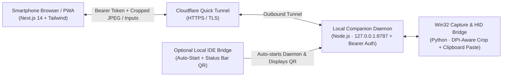

# Antigravity Mobile Remote

An open-source mobile remote control for **Google Antigravity IDE** (and VS Code) — built with **Chat Sidebar Auto-Crop**, **Agent Done Chime & Haptic Alerts**, **Voice-to-Prompt**, **1-Tap IDE Window Switching**, and **Encrypted QR Pairing**.

Live Stateless Web App: **[https://antigravity-mobile-zeta.vercel.app](https://antigravity-mobile-zeta.vercel.app)**

---

## Features

- **🎯 Chat Sidebar Auto-Crop (`Chat` / `IDE` / `Full`)**: Detects your Antigravity IDE window bounds and crops the live feed strictly to the AI Chat Sidebar so it fills your vertical smartphone screen cleanly, with exact pixel-accurate tap coordinate mapping for clicking model dropdowns, **Accept / Reject** buttons, and diffs.
- **🔒 IDE-Only Privacy Mode**: Stream *only* your IDE window — hiding your taskbar, browser tabs, and personal desktop apps.
- **🔔 "Agent Done" Chime & Vibration Alerts**: Detects sustained AI streaming activity inside the chat pane and notifies your phone with a chime, haptic vibration, and banner when a long run finishes and waits for your review.
- **🎙️ Voice-to-Prompt & Native Mobile Composer**: Dictate or type prompts using your phone's native keyboard and paste/send directly into Antigravity's built-in chat bar (works with **all** of your signed-in IDE models without extra API keys).
- **🪟 1-Tap IDE Window Switcher**: Switch between multiple open project windows on your PC in one tap.
- **🔐 Zero-Backend Security**: Your phone connects directly to your PC over Cloudflare Quick Tunnel protected by a fresh per-session 32-byte Bearer token (`agm_...`).

---

## Architecture



---

## Quick Start (Windows)

### 1. Prerequisites
- **Node.js 18+**
- **Python 3.10+** with `pillow` and `pywin32`:
  ```powershell
  pip install pillow pywin32
  ```
- **Cloudflare Tunnel CLI (`cloudflared`)**:
  ```powershell
  winget install Cloudflare.cloudflared
  ```

### 2. Clone & Run Locally
```powershell
git clone https://github.com/iamnih4l/antigravity-mobile.git
cd antigravity-mobile

# Start the companion daemon + automatic Cloudflare Quick Tunnel
node companion-service/src/server.mjs
```
The terminal prints your live `https://*.trycloudflare.com` endpoint. Fetch your local session token via `http://127.0.0.1:8787/api/tunnel` (loopback-only) or use the optional local IDE helper below for 1-scan QR codes.

### 3. Optional: Local IDE Auto-Start & 1-Scan QR Helper
If you want Antigravity IDE (or VS Code) to auto-start the daemon whenever you open any project and show a **`AG Mobile QR`** button in the bottom-right status bar:

```powershell
npm install --prefix ide-extension
npm install --prefix mobile-pwa
npx --prefix mobile-pwa tsc -p ide-extension/tsconfig.json
node scripts/install-extension.mjs
```
Then reload your IDE (`Ctrl+Shift+P` → `Developer: Reload Window`) and click **`AG Mobile QR`** in the bottom-right status bar.

### 4. Self-Host the Frontend (Optional)
You can use the hosted stateless PWA at `https://antigravity-mobile-zeta.vercel.app` or deploy `mobile-pwa/` to your own Vercel account (`Root Directory: mobile-pwa`).

---

## Project Structure

- `companion-service/` — Lightweight Node.js HTTP/WebSocket daemon, Cloudflare Quick Tunnel manager, Bearer token auth, and Win32 screen-crop & HID bridge (`win_desktop_helper.py`).
- `mobile-pwa/` — Mobile-first Next.js 14 + Tailwind CSS PWA (`LiveDesktopWorkspace.tsx`).
- `ide-extension/` — Optional local IDE auto-start & 1-scan QR helper.
- `scripts/` — Local installer & host environment discovery scripts.

---

## Security Model
- **Per-Session 32-Byte Bearer Token**: Generated fresh on daemon startup (`crypto.randomBytes(24)`). All remote requests arriving over Cloudflare Tunnel require `Authorization: Bearer <token>` and return `401 Unauthorized` otherwise.
- **URL Bar Scrubbing**: After opening a 1-tap QR link, the PWA stores the token in `localStorage` and immediately strips `?token=...` from the browser URL via `history.replaceState`.
- **Stateless Web App**: No cloud database, no telemetry, and no third-party relay servers holding your screen or prompts.

---

## Platform Support
- **Windows 10 / 11**: Full support (Per-Monitor DPI-aware Chat Auto-Crop, IDE Window Switcher, Win32 HID Click/Scroll/Paste, silent `windowsHide` background processes).
- **macOS / Linux**: Companion service & tunnel run natively; OS-specific screen-crop adapters (`screencapture`/`osascript`, `ffmpeg`/`xdotool`) are welcome via PR!

---

## License
MIT © Mohammed Nihal
