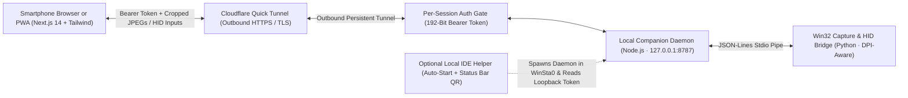
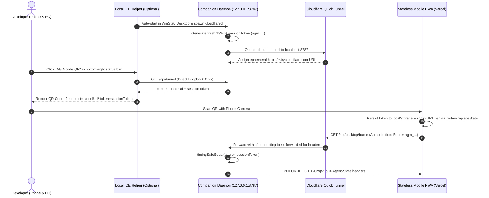
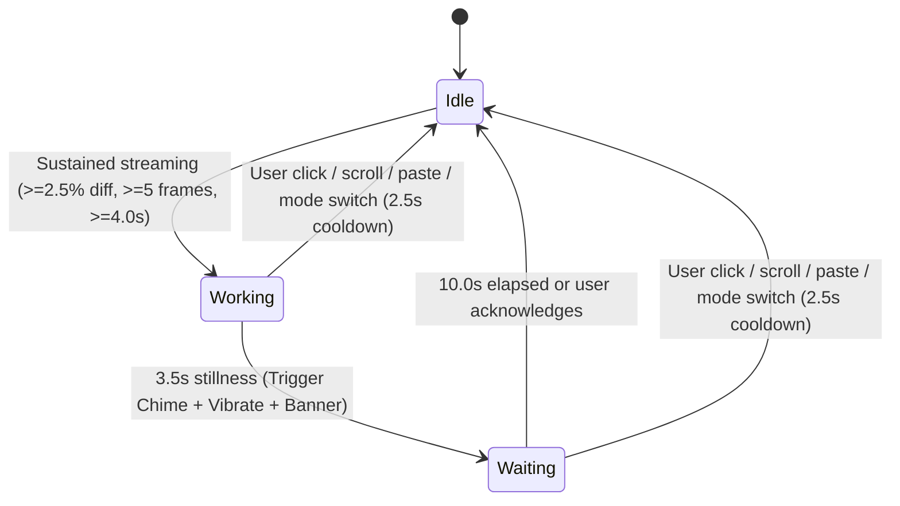

<div align="center">

# Antigravity Mobile Remote

**Control Google Antigravity IDE (and VS Code) from your smartphone like a native AI chat app.**

*Chat Sidebar Auto-Crop · Visual "Agent Done" Chime & Haptics · Voice-to-Prompt · 1-Tap Window Switching · Encrypted 1-Scan QR Pairing*

[](LICENSE)
[](https://antigravity-mobile-zeta.vercel.app)
[](https://github.com/iamnih4l/antigravity-mobile)
[](#-interactive-technical-deep-dives)
[](#-security-model)

<br/>

**[Why I Built This](#-the-story-why-i-built-this)** ·
**[Why Not Screen Mirroring?](#-why-not-just-use-remote-desktop)** ·
**[Architecture](#-system-architecture)** ·
**[How It Works](#-interactive-technical-deep-dives)** ·
**[Quick Start](#-quick-start-windows)** ·
**[API Reference](#-api-reference)** ·
**[Security](#-security-model)** ·
**[FAQ](#-troubleshooting-faq)**

</div>

---

> [!TIP]
> **100% Open-Source & Stateless:** You can pair instantly using the hosted stateless PWA at **[antigravity-mobile-zeta.vercel.app](https://antigravity-mobile-zeta.vercel.app)** — it has **zero backend, zero database, and zero telemetry**. Every frame and keystroke travels directly between your phone and your own PC over an ephemeral Cloudflare Quick Tunnel protected by a per-session 192-bit cryptographic Bearer token. You can also self-host `mobile-pwa/` on Vercel in 30 seconds.

---

## 📖 The Story: Why I Built This

I built **Antigravity Mobile Remote** out of a very real, everyday frustration.

When you use **Google Antigravity IDE** for serious agentic coding — refactoring a codebase, running test loops, or juggling two parallel project windows at once — you spend a surprising amount of time **waiting 2–5 minutes** for an agent to finish, clicking **Accept**, typing one follow-up sentence, and repeating.

I wanted to step away from my desk, grab coffee, or lie back with my iPhone and keep shipping — **without** paying for separate API keys, **without** losing Antigravity's built-in multi-model chat dropdown, and **without** pinching and zooming a microscopic 1920×1080 desktop screen.

Getting to something that actually felt effortless took three very humbling engineering pivots:

<details open>
<summary><strong>Chapter 1 — The iOS Hotspot &amp; Tailscale Wall</strong></summary>

My first instinct was to connect my phone and laptop over **Tailscale Serve / Funnel**. On home Wi-Fi it worked fine — until the moment I tethered my Windows laptop to my **iPhone Personal Hotspot** (`172.20.10.x`).

Because of how iOS isolates its Personal Hotspot subnet from its own VPN/WireGuard interface (combined with Windows marking hotspot adapters as restrictive *Public* firewall profiles), packets from Safari to the laptop silently dropped or timed out every time the phone screen locked.

**The Pivot:** Instead of fighting mobile VPNs, routers, or Windows Defender rules, I moved an outbound **Cloudflare Quick Tunnel (`cloudflared`)** directly inside the local Node.js companion daemon. Now the laptop dials *out* over HTTPS — working identically over home Wi-Fi, office networks, 5G, and iPhone Personal Hotspots, with **zero VPN apps installed on the phone** and **zero dropped tunnels when reloading IDE windows**.

</details>

<details>
<summary><strong>Chapter 2 — The 15-Tab Dashboard Mistake (and Deleting 5,200 Lines of Code)</strong></summary>

In v1, I built a massive 15-tab mobile web IDE: File Explorer, Git Diff Viewer, Terminal, Model Picker, Agent Switcher, Approvals, Workspace Discovery... and when I finally used it on my phone, I realized two hard truths:

1. **Antigravity IDE's built-in AI Chat Sidebar is sandboxed.** It doesn't expose a public external API to inject prompts into its signed-in multi-model chat bar. Calling standalone CLI/SDK wrappers meant losing the exact chat thread, context, and model selector I was already using on my laptop.
2. **Nobody wants a cluttered 15-tab dashboard on a 6-inch screen.** When I walked away from my desk, I only ever wanted to do **four things**: read what the agent just wrote, know the second it finished, tap **Accept / Reject**, and speak or type my next prompt.

**The Pivot:** I deleted **5,205 lines** of bloated UI tabs and rebuilt the entire experience around a single, razor-focused edge-to-edge mobile remote designed specifically for AI coding IDEs.

</details>

<details>
<summary><strong>Chapter 3 — The Features Generic Screen Mirroring Can't Do</strong></summary>

Once I committed to live visual streaming + real Win32 input, the real fun began — solving every pain point that makes Chrome Remote Desktop or RustDesk miserable on a phone:

- **Vertical Chat Auto-Crop:** Using `win32gui.GetWindowRect`, the helper locates your Antigravity window in real time and crops *strictly* to the right (or left) `22%–65%` AI chat panel, projecting every finger tap back to exact Per-Monitor DPI-aware physical pixels.
- **Zero-False-Alarm "Agent Done" Alerts:** A blinking cursor or a manual scroll shouldn't trigger fake notifications. So I built a lightweight `96×96` grayscale visual motion state machine with a strict multi-frame threshold and a `2.5s` post-input cooldown — chiming and vibrating your phone *only* when sustained AI streaming finishes and waits for your review.
- **Silent Windows Execution:** Early builds flashed Command Prompt windows every few seconds during background checks. Adding `windowsHide: true` across every spawned child process made the daemon completely invisible while running inside Windows' real desktop session (`WinSta0\Default`).
- **Voice-to-Prompt + Clipboard Paste:** Typing code prompts on a remote virtual keyboard is painful. Now you tap the mic, speak naturally into your phone's Web Speech API, and hit **Send** — which writes straight to the Windows clipboard, pastes via `Ctrl+V`, and presses `Enter`.

</details>

---

## ⚖️ Why Not Just Use Remote Desktop?

| Capability | Antigravity Mobile Remote | Chrome Remote Desktop / RustDesk | Standalone API / CLI Clients |
| :--- | :---: | :---: | :---: |
| Uses your **real signed-in Antigravity IDE models** (no extra API keys) | ✅ | ✅ | ❌ |
| **Chat Sidebar Auto-Crop** (fills vertical phone screen natively) | ✅ | ❌ *(tiny 16:9 desktop)* | ✅ |
| **IDE-Only Privacy Mode** (hides taskbar, browser & personal apps) | ✅ | ❌ | ✅ |
| **"Agent Done" Chime & Haptic Alert** when long AI runs finish | ✅ | ❌ | ⚠️ *(CLI only)* |
| **Native Phone Keyboard + Voice-to-Prompt** (`Ctrl+V` + `Enter`) | ✅ | ❌ *(clunky remote typing)* | ✅ |
| **1-Tap IDE Window Switcher** for parallel projects | ✅ | ❌ | ❌ |
| **Works over iPhone Personal Hotspot** without VPN apps | ✅ | ✅ | ⚠️ *(manual config)* |
| **Zero-Install Mobile Client** (1-Scan QR → Safari / Chrome PWA) | ✅ | ❌ *(native app required)* | ⚠️ |
| **100% Open-Source & Self-Hosted** (no vendor account) | ✅ | ❌ / ⚠️ | ✅ |

---

## 🏗 System Architecture

### 1. End-to-End Component Architecture



### 2. 1-Scan Encrypted QR Pairing & Zero-Leak Auth Flow



### 3. Anti-Flicker "Agent Done" Visual State Machine



---

## 🔍 Interactive Technical Deep Dives

Click any section below to explore the implementation details under the hood.

<details>
<summary><strong>🎯 1. Pixel-Accurate Cropped Tap Mapping &amp; DPI Awareness</strong></summary>

When the phone views a cropped slice of your Antigravity IDE (`mode=chat_right`, `chatPct=38%`), every JPEG returned by `GET /api/desktop/frame` carries exact physical crop metadata in HTTP response headers:

```text
X-Screen-Width: 1920
X-Screen-Height: 1080
X-Crop-Left: 1190
X-Crop-Top: 0
X-Crop-Width: 730
X-Crop-Height: 1040
X-Active-Window: antigravity-mobile%20-%20Antigravity%20IDE
X-Agent-State: working
```

When you tap anywhere on the canvas in `mobile-pwa/src/components/LiveDesktopWorkspace.tsx`, your relative touch coordinates `(relX, relY)` on the rendered `` are projected back into exact physical desktop pixels:

```ts
const screenX = Math.round(cropRect.left + (relX / renderedWidth) * cropRect.width);
const screenY = Math.round(cropRect.top  + (relY / renderedHeight) * cropRect.height);
```

On the Windows side, `companion-service/src/services/win_desktop_helper.py` calls `ctypes.windll.shcore.SetProcessDpiAwareness(2)` (Per-Monitor DPI Aware) at startup so `PIL.ImageGrab.grab()`, `win32gui.GetWindowRect()`, and `user32.SetCursorPos(screenX, screenY)` operate in the exact same `1:1` physical coordinate space — even on 125%, 150%, or 200% Windows Display Scaling laptops.

</details>

<details>
<summary><strong>🔔 2. How Visual Motion Detection Avoids False Notifications</strong></summary>

A naive frame diff fires constantly whenever a text cursor blinks, a scrollbar fades, or you tap a button. `win_desktop_helper.py` eliminates false alarms using four layered guards:

1. **96×96 Grayscale Downsampling + Intensity Threshold (`delta >= 22`)**: Subtle compression artifacts and anti-aliasing jitter are ignored completely.
2. **Area Ratio (`>= 2.5%` changed pixels)**: A blinking cursor affects `< 0.1%` of the chat pane and never counts as motion.
3. **Sustained Multi-Frame Promotion (`>= 5 active frames` AND `>= 4.0 seconds`)**: Brief UI tooltips or single-frame redraws never enter `working` state — only genuine AI token streaming does.
4. **Post-Input & Viewport Cooldown (`2.5s` on input / `2.0s` on crop change)**: Every click, scroll, paste, window switch, or view-mode toggle calls `_reset_motion()`, resetting the baseline thumbnail so your own actions never trigger a phantom *"Antigravity finished"* chime.

When `working` transitions to `waiting` (after `3.5s` of stillness), the PWA synthesizes a pleasant **D5 → A5** two-tone Web Audio chime (`587.33 Hz` → `880.0 Hz`), fires `navigator.vibrate([120, 60, 120])` on supported devices, and pops a dismissible emerald banner.

</details>

<details>
<summary><strong>📱 3. Mobile Remote Interface &amp; Controls Breakdown</strong></summary>

```text
+-------------------------------------------------------+
| [✦] Antigravity  [● Live / Working… / Ready!]         |
|     antigravity-mobile        [🔔] [⏸] [1×] [⛶] [⚙]  |
+-------------------------------------------------------+
| [Chat] [IDE] [Full]   [◧|◨] [- 38% +]   [🪟 Windows] |
+-------------------------------------------------------+
|                                                       |
|        EDGE-TO-EDGE LIVE CROPPED AI CHAT FEED         |
|     • Tap anywhere → exact physical click + ripple    |
|     • 1× / 2× / 3× zoom with smooth pan               |
|     • Cinema Mode [⛶] hides all bars for reading      |
|                                                       |
+-------------------------------------------------------+
| [✓ Accept] [■ Stop] [💬 Chat] [▲] [▼] [1×/2×/R] [⌨]   |
| [🎙️]  Type or speak prompt...        [📋]  [➤ Send]  |
+-------------------------------------------------------+
```

- **View Modes**: `Chat` (Auto-crops right/left `22%–65%` AI chat panel), `IDE` (Privacy mode: IDE window only), `Full` (Full desktop).
- **Gentle Precision Scrolling**: `▲` / `▼` send calibrated `±160` Win32 wheel steps (~4–5 lines per tap) right at the center of the visible crop so you never skip lines between scrolls.
- **One-Tap Coding Chips**:
  - `Accept` → `Alt+Enter`
  - `Stop` → `Escape`
  - `Chat` → `Ctrl+L`
  - Collapsible `Keys` tray → `Enter`, `Esc`, `Backspace`, `Tab`, `Ctrl+Enter`, `Ctrl+L`, `Ctrl+I`, `Ctrl+Shift+P`, `Ctrl+S`, `Alt+Tab`.
- **Voice-to-Prompt**: Uses the browser's `SpeechRecognition` / `webkitSpeechRecognition` API to dictate directly into the composer, then sends via Windows Unicode clipboard (`CF_UNICODETEXT`) + `Ctrl+V` + `Enter`.

</details>

<details>
<summary><strong>🗂 4. Project Structure</strong></summary>

```text
antigravity-mobile/
├── companion-service/                 # Local Node.js daemon (127.0.0.1:8787)
│   ├── src/
│   │   ├── server.mjs                 # HTTP/WS API, Bearer token auth, rate limiter
│   │   ├── db/sqlite.mjs              # Local SQLite activity & session store
│   │   └── services/
│   │       ├── desktop.mjs            # Persistent Node ↔ Python JSON-lines bridge
│   │       ├── win_desktop_helper.py  # Win32 DPI-aware capture, crop, HID & motion detector
│   │       ├── tunnel.mjs             # Daemon-owned Cloudflare Quick Tunnel manager
│   │       ├── security.mjs           # Pairing, timing-safe auth & rate limiting
│   │       ├── workspace.mjs          # Workspace & file helpers
│   │       ├── git.mjs                # Git status/diff helpers
│   │       ├── terminal.mjs           # Managed terminal helpers
│   │       └── acp-bridge.mjs         # IDE telemetry & model/agent bridge
│   └── test/
│       └── integration.test.mjs       # Automated end-to-end companion tests
├── mobile-pwa/                        # Stateless Next.js 14 + Tailwind CSS PWA
│   └── src/
│       ├── app/page.tsx               # QR query ingestion, localStorage & URL scrubbing
│       ├── components/
│       │   ├── LiveDesktopWorkspace.tsx   # Main edge-to-edge mobile remote UI
│       │   ├── ConnectionSettingsModal.tsx # 1-tap link / manual endpoint & token setup
│       │   └── ErrorBoundary.tsx          # Crash-resilient UI boundary
│       └── lib/companion-client.ts    # Typed Bearer-authenticated API client
├── ide-extension/                     # Optional local IDE auto-start + status-bar QR helper
│   ├── package.json
│   └── src/extension.ts               # Spawns daemon in WinSta0 + Webview QR generator
├── scripts/
│   ├── install-extension.mjs          # Registers optional helper in Antigravity / VS Code
│   └── discover-env.mjs               # Host runtime discovery helper
└── LICENSE                            # MIT License
```

</details>

---

## 🚀 Quick Start (Windows)

Follow this interactive checklist to go from clone to controlling your IDE from your phone in under 2 minutes.

### Prerequisites
- [ ] **Windows 10 / 11** *(macOS / Linux adapters welcome via PR!)*
- [ ] **Node.js 18+** (`node -v`)
- [ ] **Python 3.10+** with `pillow` and `pywin32`:
  ```powershell
  pip install pillow pywin32
  ```
- [ ] **Cloudflare Tunnel CLI (`cloudflared`)**:
  ```powershell
  winget install Cloudflare.cloudflared
  ```

### Path A — Run Standalone (Fastest, 60 Seconds)
- [ ] Clone the repository and start the local daemon:
  ```powershell
  git clone https://github.com/iamnih4l/antigravity-mobile.git
  cd antigravity-mobile

  # Starts http://127.0.0.1:8787 + automatic Cloudflare Quick Tunnel
  node companion-service/src/server.mjs
  ```
- [ ] Grab your live `tunnelUrl` and per-session `sessionToken` from loopback (never exposed remotely):
  ```powershell
  curl.exe http://127.0.0.1:8787/api/tunnel
  ```
- [ ] Open **[https://antigravity-mobile-zeta.vercel.app](https://antigravity-mobile-zeta.vercel.app)** on your phone, tap the **Settings (`⚙`)** icon, and paste your `tunnelUrl` and `sessionToken` (or open `https://antigravity-mobile-zeta.vercel.app?endpoint=<tunnelUrl>&token=<sessionToken>`).

### Path B — Optional Local IDE Auto-Start & 1-Scan QR Button
Want Antigravity IDE (or VS Code) to **auto-start the daemon** silently whenever you open any workspace and display a **`AG Mobile QR`** button in the bottom-right status bar?

- [ ] Build and register the local IDE helper once:
  ```powershell
  npm install --prefix ide-extension
  npm install --prefix mobile-pwa
  npx --prefix mobile-pwa tsc -p ide-extension/tsconfig.json
  node scripts/install-extension.mjs
  ```
- [ ] Reload your IDE (`Ctrl+Shift+P` → **`Developer: Reload Window`**).
- [ ] Click **`AG Mobile QR`** in the bottom-right status bar and scan the QR code with your phone camera — you're live!

<details>
<summary><strong>☁️ Path C — Self-Host the PWA on Your Own Vercel Account &amp; Add to iPhone Home Screen</strong></summary>

1. Fork this repository on GitHub.
2. Import it in **[Vercel](https://vercel.com/new)** and set **Root Directory** to `mobile-pwa`.
3. Deploy — no environment variables or databases are required.
4. *(Optional)* In Antigravity / VS Code Settings, set `antigravityMobile.webAppUrl` to your custom Vercel URL so the QR code points to your own deployment.
5. **Install as a full-screen iPhone app:** Open your paired PWA link in **Safari** → tap **Share** → **Add to Home Screen**. Your endpoint and session token persist in `localStorage` across launches.

</details>

<details>
<summary><strong>🧪 Run the Local Test Suite &amp; Production Build Check</strong></summary>

```powershell
# Companion daemon integration tests (health, auth enforcement, tunnel, desktop APIs)
node companion-service/test/integration.test.mjs

# Verify clean Next.js 14 production build
npm run build --prefix mobile-pwa
```

</details>

---

## 📡 API Reference

All remote requests arriving through Cloudflare Tunnel require `Authorization: Bearer <sessionToken>` (or `?token=<sessionToken>`). Direct `127.0.0.1` loopback calls without reverse-proxy headers are trusted locally.

<details>
<summary><strong>View Companion Daemon Endpoints (<code>127.0.0.1:8787</code>)</strong></summary>

| Method | Endpoint | Auth | Description |
| :--- | :--- | :---: | :--- |
| `GET` | `/api/health` | Public *(minimal)* / Bearer *(full)* | Liveness probe, uptime, IDE status, and authenticated workspace/tunnel metadata |
| `GET` | `/api/tunnel` | Loopback / Bearer | Current Cloudflare Quick Tunnel URL & status (`sessionToken` returned **only** on direct loopback) |
| `POST` | `/api/tunnel/restart` | Loopback / Bearer | Rotates the Cloudflare Quick Tunnel cleanly without stopping the daemon |
| `GET` | `/api/desktop` | Bearer | Screen resolution, active window title, and visible window list |
| `GET` | `/api/desktop/windows` | Bearer | Lists visible desktop windows with Antigravity / VS Code / Cursor prioritized first |
| `GET` | `/api/desktop/frame` | Bearer | Live cropped JPEG stream. Query params: `mode` (`chat_right`, `chat_left`, `ide`, `full`), `chatPct` (`22–65`), `maxWidth`, `quality`. Emits `X-Crop-*`, `X-Screen-*`, `X-Active-Window`, `X-Agent-State` headers |
| `POST` | `/api/desktop/input` | Bearer | Executes Win32 HID actions: `click`, `double_click`, `right_click`, `scroll`, `type_text` (`{ text, submit }`), `key_combo`, `focus_window` |
| `POST` | `/api/ide/telemetry` | Bearer / Loopback | Receives workspace & active-file heartbeats from the optional local IDE helper |

**Environment Variables:**
- `PORT` — Override daemon port (default: `8787`)
- `ANTIGRAVITY_MOBILE_DATA_DIR` — Custom directory for local SQLite & tunnel state files
- `DISABLE_AUTO_TUNNEL=1` — Run strictly locally without spawning `cloudflared`

</details>

---

## 🔐 Security Model

Security is enforced at the local companion boundary — never delegated to a third-party SaaS server:

- **Fresh Per-Session 192-Bit Bearer Token**: On every daemon startup, `server.mjs` generates a cryptographically random 24-byte token (`agm_` + `crypto.randomBytes(24).toString('hex')`).
- **Reverse-Proxy-Aware Auth Enforcement**: Even though `cloudflared` connects to `127.0.0.1:8787`, `isDirectLocalhost(req)` explicitly checks for `cf-connecting-ip`, `x-forwarded-for`, and `cf-ray` headers. Any proxied request without a valid token verified via `crypto.timingSafeEqual` immediately receives `401 Unauthorized`.
- **Loopback-Only Token Disclosure**: `/api/tunnel` only includes `sessionToken` when called directly from local loopback without proxy headers.
- **Immediate URL Bar Scrubbing**: After scanning a 1-tap QR code (`?endpoint=...&token=...`), `mobile-pwa/src/app/page.tsx` saves the token to `localStorage` and immediately calls `window.history.replaceState` to remove `?token=...` from the browser URL bar and history.
- **IDE-Only Privacy Mode**: Switch to `Chat` or `IDE` mode so your taskbar, notifications, email, and other desktop windows are never even cropped into the JPEG stream.
- **Zero Cloud Storage**: The Vercel PWA is static client-side code — it never sends your frames, prompts, or tokens anywhere except the tunnel URL you explicitly pair with.

> [!IMPORTANT]
> Treat your QR code and `sessionToken` like a live remote-desktop password for your PC. Whenever you restart `companion-service`, both the Cloudflare Quick Tunnel URL and the 192-bit `sessionToken` rotate automatically, immediately revoking all previous sessions.

---

## ❓ Troubleshooting FAQ

<details>
<summary><strong>The screen stream looks black or frozen when I start the daemon from a background service</strong></summary>

Windows restricts screen capture (`PIL.ImageGrab`) and mouse/keyboard injection (`SendInput` / `mouse_event`) to processes running inside your active interactive desktop session (`WinSta0\Default`). Always start `node companion-service/src/server.mjs` from a normal user terminal or via the optional local IDE helper — **not** as a Windows Service running in Session 0.

</details>

<details>
<summary><strong>My phone says "Locked" or returns 401 Unauthorized after restarting my PC</strong></summary>

By design, every restart generates a brand-new `sessionToken` and ephemeral Cloudflare Tunnel URL. Simply click **`AG Mobile QR`** inside your IDE (or check `http://127.0.0.1:8787/api/tunnel`) and re-scan once to re-pair.

</details>

<details>
<summary><strong>I'm on iOS Safari and the "Agent Done" chime didn't play</strong></summary>

iOS Safari blocks Web Audio until you interact with the page at least once. Tap the **Alert Bell (`🔔`)** icon in the top-right bar once to unlock the AudioContext (you'll hear a quick preview chime confirming audio is armed).

</details>

<details>
<summary><strong>Clicking inside the cropped chat pane taps slightly off-target</strong></summary>

Make sure `pywin32` and `pillow` are installed in the Python environment on your `PATH`, and check whether Antigravity IDE is currently visible (not minimized) on your primary monitor. You can also adjust the sidebar crop width with the **`-` / `+`** controls or switch between **Left (`◧`)** and **Right (`◨`)** chat sidebar alignment.

</details>

---

## 🗺 Roadmap & Contributing

This project is **open source** and built to stay lightweight, self-hosted, and community-driven. Contributions are very welcome!

- [x] Windows 10/11 Per-Monitor DPI-Aware Chat Auto-Crop & HID Bridge
- [x] Daemon-owned Cloudflare Quick Tunnel (iPhone Personal Hotspot safe)
- [x] Visual Stream-Motion "Agent Done" Chime & Vibration Alerts
- [x] Voice-to-Prompt + Precision Scroll (`±160`) + 1-Tap Window Switcher
- [ ] **macOS Capture & HID Adapter** (`screencapture` + `osascript` / Quartz CGEvent — *PRs welcome!*)
- [ ] **Linux X11 / Wayland Adapter** (`ffmpeg` / `grim` + `xdotool` / `ydotool` — *PRs welcome!*)
- [ ] **Pinch-to-Zoom Gesture** directly on the live stream canvas
- [ ] **Multi-Monitor Selection** for dual/ultrawide desktop setups

To contribute:
1. Fork the repo and create a feature branch (`git checkout -b feat/macos-adapter`).
2. Run `node companion-service/test/integration.test.mjs` and `npm run build --prefix mobile-pwa`.
3. Open a Pull Request describing your change and how you tested it.

---

## 📄 License

**MIT License** © [Mohammed Nihal](https://github.com/iamnih4l) — see [LICENSE](LICENSE) for full details.
