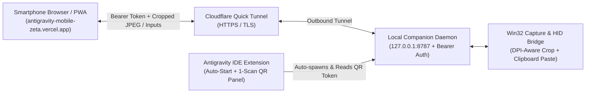

# Antigravity Mobile Remote

Control your **Google Antigravity IDE** (or VS Code) AI Agent Chat Sidebar from your smartphone — with **Chat Sidebar Auto-Crop**, **Agent Done Chime & Vibration Alerts**, **Voice-to-Prompt**, **1-Tap IDE Window Switching**, and **Zero-Setup Encrypted QR Pairing**.

Live Stateless Web App: **[https://antigravity-mobile-zeta.vercel.app](https://antigravity-mobile-zeta.vercel.app)**

---

## Why Not Just Chrome Remote Desktop?

Generic screen mirroring squishes a 1920×1080 desktop onto a tiny phone screen and forces you to type prompts on a clumsy virtual keyboard. **Antigravity Mobile Remote** is built specifically for AI-assisted coding workflows:

- **🎯 Chat Sidebar Auto-Crop (`Chat` / `IDE` / `Full`)**: Automatically detects your Antigravity IDE window bounds and crops the live feed strictly to the AI Chat Sidebar so it fills your vertical phone screen at crisp resolution — with exact pixel-accurate tap coordinate mapping for clicking model dropdowns, **Accept / Reject** buttons, and diffs.
- **🔒 IDE-Only Privacy Mode**: Stream *only* your Antigravity IDE window (hiding your taskbar, browser tabs, and personal apps).
- **🔔 "Agent Done" Chime & Vibration Alerts**: Walks away while an agent runs? Visual stream-motion detection notifies your phone with a chime, haptic vibration, and banner the moment Antigravity finishes or pauses for your approval.
- **🎙️ Voice-to-Prompt & Native Mobile Composer**: Dictate or type long coding prompts using your phone's native keyboard and send them straight into Antigravity's built-in chat bar (using **all** of your signed-in IDE models without extra API keys).
- **🪟 1-Tap IDE Window Switcher**: Jump between parallel project windows (e.g., multiple open Antigravity workspaces) with a single tap.
- **📱 Zero Phone App Install & Zero Backend Cost**: Uses a 100% stateless PWA paired directly to your own machine via Cloudflare Quick Tunnel + per-session Bearer token embedded in a 1-scan QR code.

---

## Architecture



> **Privacy First**: The hosted Vercel web app is 100% static/stateless. It has **no backend database** and never sees your screen, code, or prompts. Your phone communicates directly with your own PC's encrypted Cloudflare tunnel using a randomly generated 32-byte session token (`agm_...`).

---

## Quick Start (30 Seconds — Windows)

### Prerequisites
- **Node.js 18+**
- **Python 3.10+** with `pillow` and `pywin32`:
  ```powershell
  pip install pillow pywin32
  ```
- **Cloudflare Tunnel CLI (`cloudflared`)**:
  ```powershell
  winget install Cloudflare.cloudflared
  ```

### Install the Standalone Extension (`.vsix`)
1. Download **`antigravity-mobile-bridge-2.0.0.vsix`** from Releases (or build locally with `node scripts/package-vsix.mjs`).
2. Install into Antigravity IDE (or VS Code):
   ```powershell
   antigravity-ide --install-extension antigravity-mobile-bridge-2.0.0.vsix
   ```
   *(Or in IDE: Extensions panel → `...` menu → **Install from VSIX...**)*
3. Reload Antigravity IDE (`Ctrl+Shift+P` → `Developer: Reload Window`).
4. Click **`AG Mobile QR`** in the bottom-right status bar and scan the QR code with your phone camera!

*(Tip: On iPhone Safari, tap **Share → Add to Home Screen** to install as a full-screen mobile app.)*

---

## Building from Source / Self-Hosting

```bash
# 1. Clone repo
git clone https://github.com/iamnih4l/antigravity-mobile.git
cd antigravity-mobile

# 2. Install dependencies & build standalone VSIX
npm install --prefix ide-extension
npm install --prefix mobile-pwa
node scripts/package-vsix.mjs

# 3. (Optional) Self-host the PWA on Vercel
# Deploy mobile-pwa/ to Vercel and set `antigravityMobile.pwaUrl` in IDE settings.
```

---

## Security Model
- **Per-Session 32-Byte Bearer Token**: Generated fresh on daemon startup (`crypto.randomBytes(24)`). All remote requests arriving over Cloudflare Tunnel require `Authorization: Bearer <token>` (embedded automatically in the IDE's QR code) and return `401 Unauthorized` otherwise.
- **URL Bar Scrubbing**: Upon scanning the QR code, the PWA persists the token to `localStorage` and immediately strips `?token=...` from the browser URL via `history.replaceState`.
- **No Persistent Cloud State**: Stopping the daemon or restarting your PC immediately terminates the tunnel and invalidates the session token.

---

## Platform Support
- **Windows 10 / 11**: Full support (Per-Monitor DPI-aware Chat Auto-Crop, IDE Window Switcher, Win32 HID Click/Scroll/Paste, silent `windowsHide` background daemon).
- **macOS / Linux**: Companion service & tunnel run natively; OS-specific screen-crop adapters (`screencapture`/`osascript`, `ffmpeg`/`xdotool`) are welcome via PR!

---

## License
MIT © Mohammed Nihal
